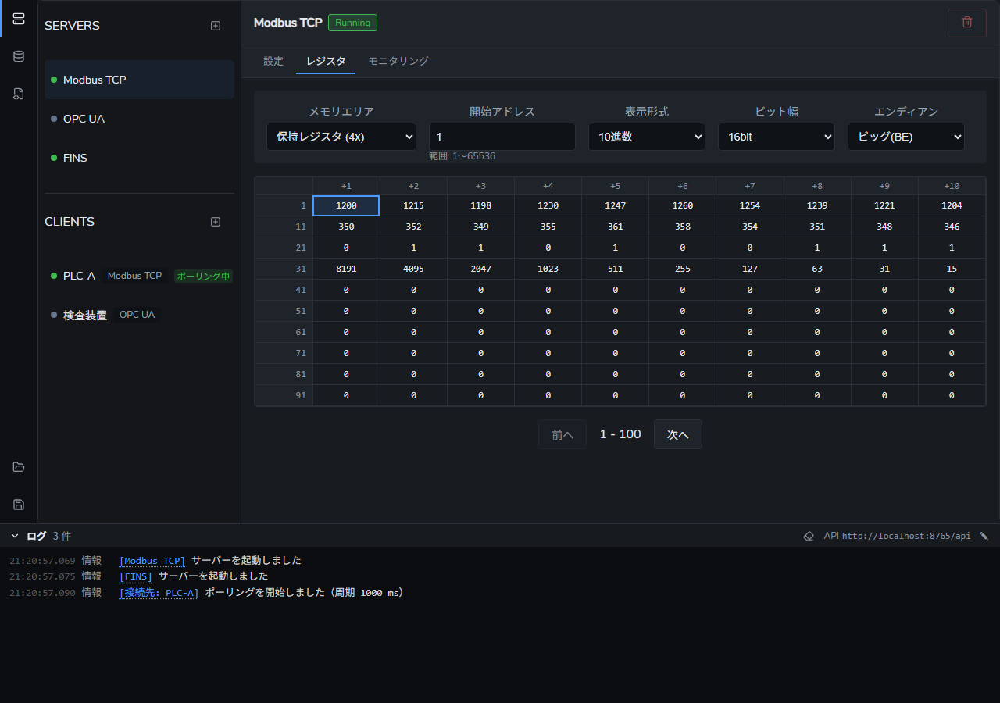

# Karakuri

Karakuri は Modbus（TCP/RTU/ASCII）・OPC UA・FINS（オムロン）に対応した PLC シミュレーターです。サーバーとして待ち受けるだけでなく、クライアントとして外部の機器につないでコマンドを送ることもできます。GUI でレジスタや変数の値を確認・編集でき、JavaScript でカスタムロジックを記述できます。



## 機能

- **サーバー（Karakuri が待ち受ける側）**
  - **Modbus TCP / Modbus RTU / Modbus ASCII**
    - 全 UnitID (1-247) に応答（個別に無効化可能）
    - コイル、ディスクリート入力、保持レジスタ、入力レジスタ（各 65536 点）
  - **OPC UA**（セキュリティなし・匿名認証）
    - 変数管理で定義した変数をノードとして公開
    - 構造体フィールドと配列要素を個別のノードとしてブラウズ可能
    - フィールド・要素単位でのサブスクリプション（変更通知）に対応
    - スカラー・配列（多次元を含む）・構造体の読み書き対応
  - **FINS**（オムロン。FINS/UDP と FINS/TCP を同じポートで待ち受け）
    - エリア: CIO・WR・HR・AR・DM・タイマ・カウンタ・EM（バンク 0〜18）
    - コマンド: メモリエリアの読み出し・書き込み・一括書き込み・複合読み出し、CPU ユニット情報・ステータス、時計
    - タイマ・カウンタは値を持つだけで、時間では進みません。実機との接続は未確認です
  - 異なるプロトコルのサーバーを同時に起動可能（各プロトコル 1 つずつ。メモリ空間はサーバーごとに独立）
  - レジスタの値と UnitID の応答設定は、サーバーを止めて起動し直しても残る

- **クライアント（外部の機器へつなぐ側）**
  - **Modbus TCP / OPC UA / FINS** の接続先を、いくつでも追加可能
  - **コマンド**: 項目から組み立てる方式と、16 進で直接入れる方式。送受信のバイト列・応答の解釈・履歴を表示。組み立てたコマンドは名前を付けて保存できる
  - **ポーリング**: 読み取りのコマンドを周期的に送り、最後の結果と値を表示
  - **変数とのマッピング**（Modbus TCP / FINS）: 変数を接続先のアドレスにマッピングすると、ポーリング中に変数と同期（通信エラー・書き込み未反映の状態を表示）
  - **OPC UA**: Read / Write / Browse、ノードをツリーでたどって選ぶ「参照」、サブスクリプション（値が変わったときに機器の側から知らせが届く）、セキュリティポリシーとユーザー名での接続

- **変数管理**
  - **IEC 61131-3 準拠のデータ型**
    - スカラー型: BOOL, SINT, INT, DINT, LINT, USINT, UINT, UDINT, ULINT, REAL, LREAL, STRING[n], TIME, DATE, TIME_OF_DAY, DATE_AND_TIME
    - 配列型: `ARRAY[0..9] OF INT`、多次元は `ARRAY[0..2, 0..4] OF INT`（画面からは 3 次元まで）
    - 構造体型: カスタム構造体定義（ネスト可能）
  - 構造体フィールドと配列要素を行単位に展開して表示・編集
  - 変数の名前・データ型は後から変更可能（データ型を変えると値は既定値に戻り、マッピングは残る）
  - **マッピング**: 変数を、サーバーのレジスタやクライアントの接続先のアドレスにマッピング（複数可）
    - 読み書きするエリアとビット幅は変数の型で決まる（BOOL はビット、ほかはワード）
    - 同じレジスタを複数の変数で使っている場合は、ダイアログと一覧の両方で警告
    - OPC UA は、変数ごとに公開するかどうかとアクセスモード（RO / WO / R/W）を設定
  - **一括マッピング編集**: 全変数のマッピングを表形式でまとめて設定

- **レジスタ操作**（サーバーの「レジスタ」タブ）
  - 10 列の表でレジスタの値を一覧表示（100ms 周期で更新）。キーボードで移動・書き込み
  - 10 進 / 16 進 / 8 進 / 2 進の表示、1bit / 16bit / 32bit / 64bit（リトルエンディアン / ビッグエンディアン）
  - Modbus のアドレスは 1 始まり、FINS のビットは「ワード.ビット」（`100.05`）で表示
  - アドレスを入れる場所にはエリアの範囲を表示し、範囲外の入力は保存・追加を止める

- **モニタリング**（サーバーの「モニタリング」タブ）
  - 任意のレジスタを登録してリアルタイム監視・書き込み
  - ビット幅・エンディアン・表示形式を行ごとに設定、ドラッグ＆ドロップで並べ替え
  - 設定はファイルに自動保存（次回起動時に復元）

- **スクリプト**
  - JavaScript で周期処理（100ms〜1 時間）を記述。const / let が使える
  - `plc` オブジェクトで変数を読み書きし、クライアントの接続先へコマンドを送れる
  - `console.log()` の出力・警告・エラーをコンソールに表示（スクリプト名・時刻つき）
  - 「1 回実行」ボタンで、入力中のコードを保存せずに 1 回だけ実行

- **アプリ全体のログ**
  - サーバーの起動・停止、クライアントの通信エラー、スクリプトの開始・停止とエラーなどを、どのページからも画面の下の欄で確認
  - ログの出どころを押すと、そのサーバー・接続先・スクリプトの画面に移る

- **REST HTTP API**
  - アプリをネットワーク経由で外部から操作可能（デフォルトポート: 8765）
  - 対応操作: サーバーの追加・起動・停止・設定、レジスタの読み書き、変数の作成・更新・削除、プロジェクトのエクスポート / インポート

- **プロジェクト管理**
  - サーバーとクライアントの設定・スクリプト・変数・モニタリング項目を JSON ファイルに保存・読み込み（GUI または HTTP API）

## インストール

Windows 用の exe は [Releases](https://github.com/bamchoh/karakuri/releases) から入手できます（zip に `Karakuri.exe` が 1 つ）。

### ソースからビルドする

必要なもの:

- Go 1.25 以上
- Node.js 24（CI で使っているバージョン）
- [Wails CLI](https://wails.io/docs/gettingstarted/installation)
- [go-task](https://taskfile.dev/)

```bash
# 依存関係のインストール
go mod tidy
cd frontend && npm install && cd ..

# プロダクションビルド
task build
```

ビルド成果物は `build/bin/` に生成されます。

## 開発

```bash
# 開発モード（画面はホットリロード。Go 側を変更したら起動し直す）
task dev

# 全テスト実行（Go のテストと、画面の単体テスト）
task test

# 画面の単体テスト（Vitest）だけ
task test-frontend

# 画面の確認用テスト（Playwright）。先に開発サーバーを起動しておく
task e2e

# 画面のコードを整形する（Prettier）
cd frontend && npm run format

# Go バインディングの再生成
wails generate module
```

画面の確認用テストは、つないだ先のアプリの状態を消します。手順と注意は [frontend/e2e/README.md](frontend/e2e/README.md) を参照してください。

## 使い方

画面の左のサイドバーで「Connections（通信）」「Variables（変数）」「Scripts（スクリプト）」を切り替えます。画面の下には、どのページでもアプリ全体のログの欄があります。

### サーバー

1. 「Connections」を開くと、左に「SERVERS」と「CLIENTS」の一覧が出る
2. 「サーバーを追加」でプロトコルを選んで追加する
3. 一覧でサーバーを選ぶと、右に「設定 / レジスタ / モニタリング」のタブが出る（OPC UA は設定だけ）
4. 「設定」でアドレス・ポートなどを変更して保存する（起動中は変更できない）
5. 一覧の再生・停止ボタンで起動・停止する

**UnitID 応答設定**（Modbus）: 既定では全ての UnitID (1-247) に応答します。応答させたくない UnitID は、設定のタブでチェックを外します。オフにした UnitID には、例外応答も返しません。

### レジスタ

1. サーバーを選び、「レジスタ」タブを開く
2. メモリエリア・開始アドレス・表示形式・ビット幅・エンディアンを選ぶ
3. セルをクリックするか、矢印キーで選んで Enter を押すと、書き込みのダイアログが開く

FINS の CIO や DM などをビットで見るときは、ワードのエリアを選んで、ビット幅で「1bit」を選びます（1 行に 1 ワード分の 16 ビットが並びます）。

### モニタリング

1. サーバーを選び、「モニタリング」タブを開く
2. 「追加」で、メモリエリア・開始アドレス・個数・ビット幅・エンディアン・表示形式を指定して登録する
3. 登録した項目の値がリアルタイムで更新される。値をクリックすると書き込める

### クライアント

1. 「Connections」の「接続先を追加」で、プロトコルと名前を決めて追加する
2. 「設定」タブで、接続先（ホスト・ポート、OPC UA ならエンドポイント URL など）を入れて保存する
3. 「コマンド」タブの「新しいコマンド」で、コマンドを組み立てて送信する。「保存して閉じる」で、名前を付けて残せる
   - 16 進で直接入れることもできる（Modbus は PDU、OPC UA はサービスのリクエスト本体、FINS はコマンドコード + パラメーター）
   - 送った結果は「結果と履歴」に残る
4. 「ポーリング」タブで、読み取り項目と周期を決めて開始する
5. OPC UA の接続先では、「サブスクリプション」タブで監視するノードを登録できる。NodeId の欄の「参照」で、ノードをツリーから選べる

接続は、最初の送信のときにつなぎます。

### 変数

「Variables」で IEC 61131-3 準拠の変数を管理します。

1. 「変数を追加」で、型カテゴリ（スカラー・配列・構造体）とデータ型を選んで作成する
2. 値のセルをクリックすると値を編集できる。数値は 10 進のほか、16 進（`0x`）・2 進（`0b`）でも入れられる
3. マッピングのセルをクリックすると、マッピング設定のダイアログが開く
   - マッピング先は、追加済みのサーバーと、クライアントの接続先（Modbus TCP / FINS）
   - OPC UA サーバーへは「プロトコル公開設定」で公開する。NodeID は `ns=2;s=変数名` の形（構造体のフィールドは `変数名.フィールド`、配列の要素は `変数名[添字]`）
4. 右クリックのメニューから、名前・データ型の編集、マッピング、削除ができる
5. 「一括マッピング編集」で、プロトコルを選んで全変数のマッピングをまとめて設定できる（アドレスを空欄にするとマッピングを削除）

キーボード: 矢印キーで移動と展開、Enter で値の編集、Insert で追加、F2 で編集、M でマッピング、Delete で削除。

クライアントの接続先にマッピングした変数は、ポーリング中に機器と同期します。最初は機器の値を読み込み、そのあと変数を変えると機器に書き込みます。値の右に「通信エラー」「書き込み未反映」などの状態が出ます。

#### 構造体型の管理

「構造体型管理」から、構造体型を登録・編集・削除できます。フィールドにはスカラー・配列・構造体を指定できます（ネスト可）。編集のとき、型名は変更できません。

### スクリプト

「Scripts」で、JavaScript の周期処理を記述します。

```javascript
// 変数 Counter を 1 ずつ増やし、100 を超えたら 0 に戻す
const count = plc.readVariable("Counter") + 1;
plc.writeVariable("Counter", count > 100 ? 0 : count);

// 構造体のフィールドと配列の要素
plc.writeStructField("Motor1", "speed", count * 10);
plc.writeArrayElement("Values", 0, count);
```

スクリプトから読み書きするのは変数です。レジスタを動かしたいときは、変数をレジスタにマッピングします（変数とレジスタは双方向に同期します）。

エラーはコンソールに `[ERROR]` として表示されます（周期実行では、同じエラーが続く間は最初の 1 回だけ）。エラーが出ても、周期実行は続きます。

#### 利用可能な API

**変数アクセス API**:

| メソッド                                       | 説明                             |
| ---------------------------------------------- | -------------------------------- |
| `plc.readVariable(name)`                       | 変数の値を読み取り               |
| `plc.writeVariable(name, value)`               | 変数に値を書き込み               |
| `plc.readArrayElement(name, index)`            | 配列変数の要素を読み取り         |
| `plc.writeArrayElement(name, index, value)`    | 配列変数の要素を書き込み         |
| `plc.readStructField(name, fieldName)`         | 構造体変数のフィールドを読み取り |
| `plc.writeStructField(name, fieldName, value)` | 構造体変数のフィールドを書き込み |
| `plc.hasVariable(name)`                        | 変数があるかどうか               |
| `plc.getVariables()`                           | 全変数の一覧を取得               |

変数の関数は、失敗するとスクリプトのエラー（例外）になります（変数がない・フィールドや要素がない・型が違う・型に合わない値を書いた）。`try` / `catch` で受け取れます。あるかどうか分からない変数は、先に `plc.hasVariable()` で確かめます。

> **注意**: `plc.readVariable()` で LINT/ULINT の値が ±2^53 を超えていた場合、JavaScript の `Number` の精度の都合で、コンソールに `[WARN]` が出ます。大きな値を扱う場合は、下の **LINT/ULINT BigInt API** を使ってください。

**LINT/ULINT BigInt API（64 ビット整数を精度を失わずに操作）**:

| メソッド                       | 説明                                         |
| ------------------------------ | -------------------------------------------- |
| `plc.readLintBig(name)`        | LINT 変数を BigInt として読み取り            |
| `plc.writeLintBig(name, val)`  | BigInt または Number を LINT 変数に書き込み  |
| `plc.readUlintBig(name)`       | ULINT 変数を BigInt として読み取り           |
| `plc.writeUlintBig(name, val)` | BigInt または Number を ULINT 変数に書き込み |

```javascript
// LINT 変数に 1 加算する例
plc.writeLintBig("counter", plc.readLintBig("counter") + 1n);

// ULINT 変数を 16 進リテラルで書き込む例
plc.writeUlintBig("flags", 0xffffffffffffffffn);
```

**TIME/DATE シンタックスシュガー**:

読み取り〜数値変換〜書き込みをワンステップで実行します。

| メソッド                             | 型            | 内部値 | 説明                                  |
| ------------------------------------ | ------------- | ------ | ------------------------------------- |
| `plc.readTimeMs(name)`               | TIME          | ms     | TIME 変数をミリ秒（数値）で読み取り   |
| `plc.writeTimeMs(name, ms)`          | TIME          | ms     | ミリ秒（数値）を TIME 変数に書き込み  |
| `plc.readDateSec(name)`              | DATE          | 秒     | DATE 変数を Unix 秒（数値）で読み取り |
| `plc.writeDateSec(name, sec)`        | DATE          | 秒     | Unix 秒（数値）を DATE 変数に書き込み |
| `plc.readTimeOfDayMs(name)`          | TIME_OF_DAY   | ms     | TOD 変数をミリ秒（数値）で読み取り    |
| `plc.writeTimeOfDayMs(name, ms)`     | TIME_OF_DAY   | ms     | ミリ秒（数値）を TOD 変数に書き込み   |
| `plc.readDateAndTimeSec(name)`       | DATE_AND_TIME | 秒     | DT 変数を Unix 秒（数値）で読み取り   |
| `plc.writeDateAndTimeSec(name, sec)` | DATE_AND_TIME | 秒     | Unix 秒（数値）を DT 変数に書き込み   |

```javascript
// TIME_OF_DAY 変数に 1 秒加算する例
plc.writeTimeOfDayMs("TOD1", plc.readTimeOfDayMs("TOD1") + 1000);

// DATE 変数を 1 日進める例
plc.writeDateSec("date1", plc.readDateSec("date1") + 86400);
```

**TIME/DATE 文字列変換 API**:

| メソッド                     | 説明                                           |
| ---------------------------- | ---------------------------------------------- |
| `plc.parseTime(str)`         | `"T#1h30m"` → ミリ秒（number）                 |
| `plc.formatTime(ms)`         | ミリ秒（number） → `"T#1h30m"`                 |
| `plc.parseDate(str)`         | `"D#2024-01-01"` → Unix 秒（number）           |
| `plc.formatDate(sec)`        | Unix 秒（number） → `"D#2024-01-01"`           |
| `plc.parseTimeOfDay(str)`    | `"TOD#12:30:15"` → ミリ秒（number）            |
| `plc.formatTimeOfDay(ms)`    | ミリ秒（number） → `"TOD#12:30:15"`            |
| `plc.parseDateAndTime(str)`  | `"DT#2024-01-01-12:30:15"` → Unix 秒（number） |
| `plc.formatDateAndTime(sec)` | Unix 秒（number） → `"DT#2024-01-01-12:30:15"` |

**外部の機器（クライアントの接続先）へ送る API**:

| メソッド                           | 説明                                                                                    |
| ---------------------------------- | --------------------------------------------------------------------------------------- |
| `plc.sendCommand(client, command)` | 保存したコマンドを、接続先とコマンドの名前で送る                                        |
| `plc.sendRequest(client, hex)`     | 16 進で指定したリクエスト（Modbus なら PDU）を、名前で指定した接続先に送る              |
| `plc.getVariableStatus(name)`      | 接続先にマッピングした変数の同期の状態（`state` / `writePending` / `error` / `client`） |

どちらの送信も、応答（またはタイムアウト）を待ってから、`{ status, error, values, sent, received, elapsedMs }` を返します。`status` は `ok` / `exception` / `timeout` / `error`。接続先・コマンドが見つからないときも、例外ではなく `status: "error"` を返します。送った内容は、画面の「結果と履歴」にも残ります。

```javascript
const r = plc.sendCommand("PLC-A", "速度を読む");
if (r.status === "ok") {
  plc.writeVariable("Speed", r.values[0].word); // 読み取った値（ワードは word、ビットは bit）
} else {
  console.log("失敗: " + r.error);
}
```

> 送信は応答を待つ間、そのスクリプトを止めます（応答しない接続先なら、タイムアウトの時間だけ周期が延びます）。

### プロジェクトの保存と読み込み

ヘッダーの「プロジェクトオープン」「プロジェクト保存」のボタンで、以下を JSON ファイルとして保存・復元できます。

- 全サーバーの設定（プロトコル、接続設定）と UnitID 応答設定
- クライアントの接続先（設定・保存したコマンド・ポーリングの読み取り項目・サブスクリプションの監視項目）
- スクリプト
- 変数・構造体型・マッピング
- モニタリング項目

レジスタ（メモリ）の値は保存しません。OPC UA の接続先のパスワードは、ファイルにそのまま保存されます。

### REST HTTP API

アプリを起動すると、HTTP REST API のサーバーも起動します。デフォルトポートは **8765**。

ヘッダーに表示された URL（例: `http://localhost:8765/api`）の右にある ✎ ボタンでポートを変更できます。変更は次回起動時にも反映されます。

プロトコルタイプは `modbus-tcp` / `modbus-rtu` / `modbus-ascii` / `opcua` / `fins` です。

**サーバー管理**

```bash
# サーバー一覧取得
curl http://localhost:8765/api/servers

# Modbus TCP サーバーを起動
curl -X POST http://localhost:8765/api/servers/modbus-tcp/start

# Modbus TCP サーバーを停止
curl -X POST http://localhost:8765/api/servers/modbus-tcp/stop
```

**レジスタ読み書き**

```bash
# 使えるメモリエリアの一覧
curl http://localhost:8765/api/memory/modbus-tcp/areas

# ホールディングレジスタをアドレス 0 から 10 ワード読み取り（アドレスは 0 始まり）
curl "http://localhost:8765/api/memory/modbus-tcp/holdingRegisters/words?address=0&count=10"

# アドレス 5 に値 100 を書き込み
curl -X PUT http://localhost:8765/api/memory/modbus-tcp/holdingRegisters/words/5 \
  -H "Content-Type: application/json" -d '{"value": 100}'

# コイルのアドレス 3 から 8 点読み取り
curl "http://localhost:8765/api/memory/modbus-tcp/coils/bits?address=3&count=8"

# コイルのアドレス 0 を ON に書き込み
curl -X PUT http://localhost:8765/api/memory/modbus-tcp/coils/bits/0 \
  -H "Content-Type: application/json" -d '{"value": true}'
```

**変数管理**

```bash
# 変数一覧取得
curl http://localhost:8765/api/variables

# 変数を作成
curl -X POST http://localhost:8765/api/variables \
  -H "Content-Type: application/json" \
  -d '{"name": "counter", "dataType": "INT", "value": 0}'

# 変数の値を更新（ID は変数一覧から取得）
curl -X PUT http://localhost:8765/api/variables/{id}/value \
  -H "Content-Type: application/json" -d '{"value": 42}'
```

**プロジェクトのエクスポート/インポート**

```bash
# プロジェクトをファイルに保存
curl http://localhost:8765/api/project/export > project.json

# プロジェクトをファイルから復元
curl -X POST http://localhost:8765/api/project/import \
  -H "Content-Type: application/json" -d @project.json
```

PowerShell の場合:

```powershell
# エクスポート
(Invoke-WebRequest "http://localhost:8765/api/project/export").Content | Out-File project.json

# インポート
Invoke-WebRequest -Method Post "http://localhost:8765/api/project/import" `
  -ContentType "application/json" -InFile project.json
```

## アーキテクチャ

プロトコルの実装はアプリ本体に組み込まれています（exe は 1 つ）。プロトコルごとのコードは `internal/protocols/<名前>/` に分かれていて、本体側はプロトコル固有の値を持ちません。

```
┌──────────────────────────────────────────────────────────────┐
│  Karakuri（1 つのプロセス）                                   │
│                                                              │
│  画面（React） ⇄ PLCService ⇄ 変数ストア ⇄ スクリプト         │
│                      │                                       │
│   protocol.ServerFactory / ClientFactory などのインターフェース │
│                      │                                       │
│   ┌──────────────────┴───────────────────┐                   │
│   │ internal/protocols/modbus            │ Modbus TCP / RTU / ASCII
│   │ internal/protocols/opcua             │ OPC UA            │
│   │ internal/protocols/fins              │ FINS              │
│   └──────────────────────────────────────┘                   │
└──────────────────────────────────────────────────────────────┘
```

```
internal/
├── domain/           # ドメイン層
│   ├── protocol/     # プロトコル共通インターフェース（サーバー・クライアント）
│   ├── variable/     # 変数エンティティ（IEC 61131-3 データ型）
│   └── script/       # スクリプトエンティティ
├── application/      # アプリケーション層（プロトコル固有の値を持たない）
│   ├── plc_service*.go # メインサービス（サーバー・クライアント・変数・スクリプト・モニタリング）
│   └── dto.go          # DTO 定義
├── protocols/        # プロトコルの実装
│   ├── protocols.go  # 組み込むプロトコルの一覧
│   ├── modbus/       # Modbus TCP / RTU / ASCII
│   ├── opcua/        # OPC UA
│   └── fins/         # FINS
└── infrastructure/   # インフラ層（プロトコル固有の実装は含まない）
    ├── httpapi/      # REST HTTP API サーバー（net/http）
    ├── adapter/      # 変数とレジスタ・接続先のアドレスの同期
    ├── applog/       # アプリ全体のログ
    ├── appconfig/    # 設定フォルダの決定
    └── scripting/    # JavaScript エンジン（goja）
```

各プロトコルの実装は、起動時に `protocol.ServerFactory`（クライアントは `protocol.ClientFactory`）として登録され、PLCService はインターフェースを通じて操作します。画面は、プロトコルが返すスキーマ（設定項目・コマンドの定義・メモリエリア）から入力欄を作ります。

プロトコルを追加する手順は [docs/protocol-developer-guide.md](docs/protocol-developer-guide.md) を参照してください。

## 設定ファイル

設定は以下の場所に自動保存されます：

| ファイル                 | 内容                                      |
| ------------------------ | ----------------------------------------- |
| `monitoring_config.json` | モニタリング項目の登録内容                |
| `httpapi_config.json`    | HTTP API のポート番号（デフォルト: 8765） |

- **Windows**: `%APPDATA%\Karakuri\`
- **macOS**: `~/Library/Application Support/Karakuri/`
- **Linux**: `~/.config/Karakuri/`

サーバー・クライアント・変数・スクリプトは自動では保存しません。残したいときは、プロジェクトとして保存します。

以前のバージョンの設定フォルダ（`PLCSimulator`）がある場合は、初回起動時に設定ファイルを新しいフォルダへコピーして引き継ぎます（旧フォルダは残ります）。

## 技術スタック

- **バックエンド**: Go + [Wails v2](https://wails.io/)
- **フロントエンド**: React + TypeScript + Vite（ビルドターゲット: Chrome 87+, Edge 88+, Firefox 78+, **Safari 14+**）
- **Modbus**: [simonvetter/modbus](https://github.com/simonvetter/modbus)（TCP サーバー）。RTU / ASCII・クライアントは自前の実装
- **OPC UA**: [bamchoh/uastack](https://github.com/bamchoh/uastack)
- **FINS**: 自前の実装
- **JavaScript エンジン**: [goja](https://github.com/dop251/goja)
- **テスト**: Go の標準のテスト、[Vitest](https://vitest.dev/)（画面の単体テスト）、[Playwright](https://playwright.dev/)（画面の確認用テスト）
- **タスクランナー**: [go-task](https://taskfile.dev/)

> **注**: フロントエンドのビルドターゲットに Safari 14+ が必要なのは、LINT/ULINT の値編集に JavaScript `BigInt` を使用しているためです。

## ライセンス

MIT License

Copyright (c) 2026 bamchoh
